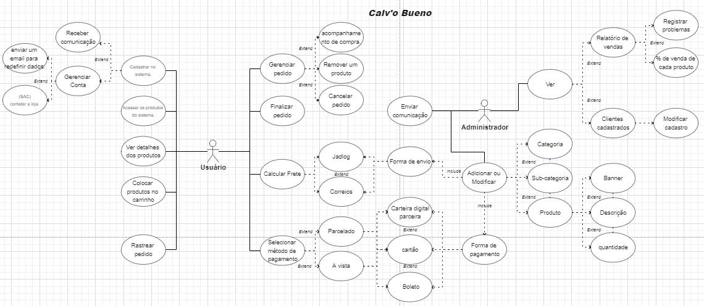
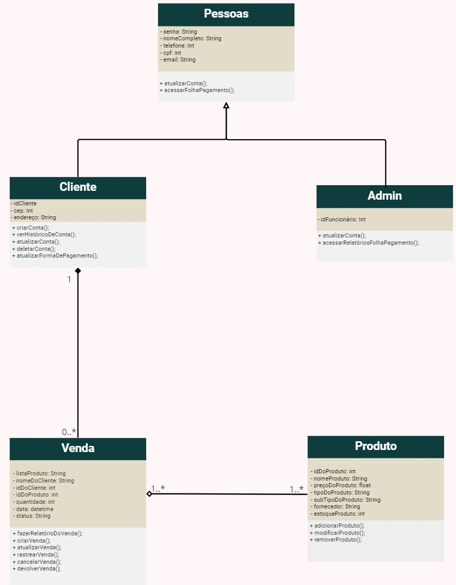
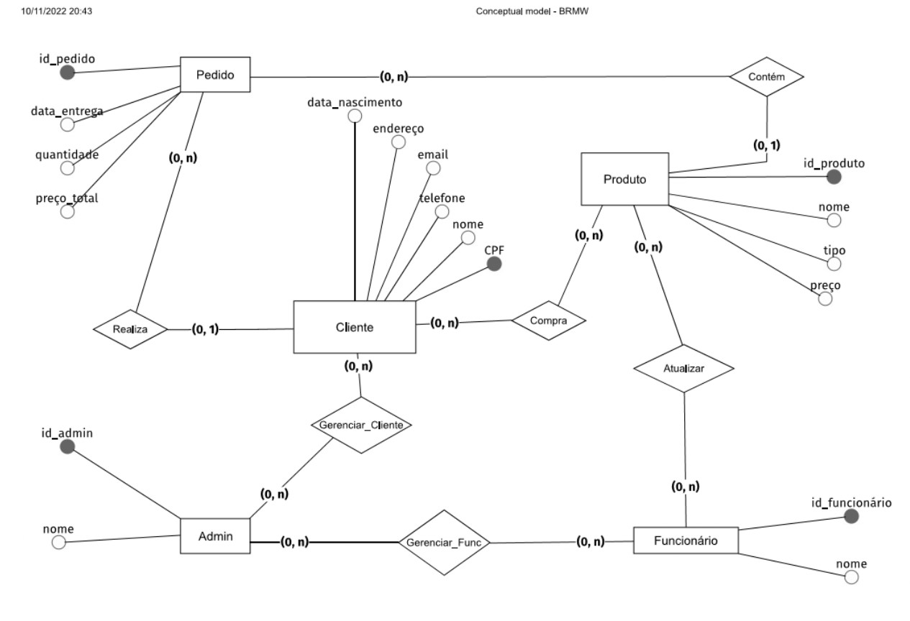
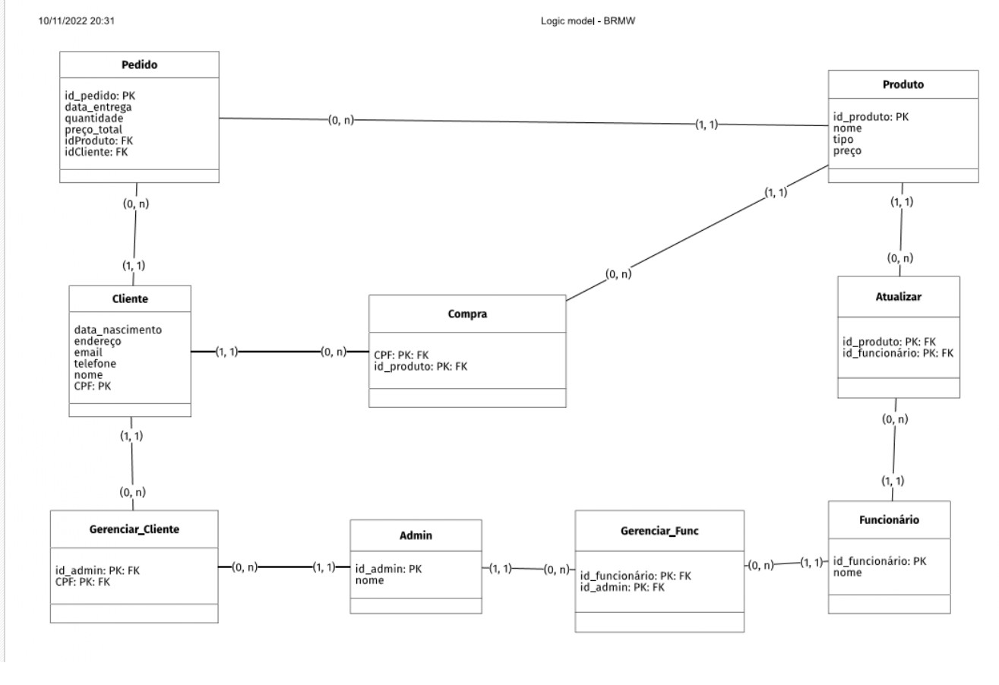
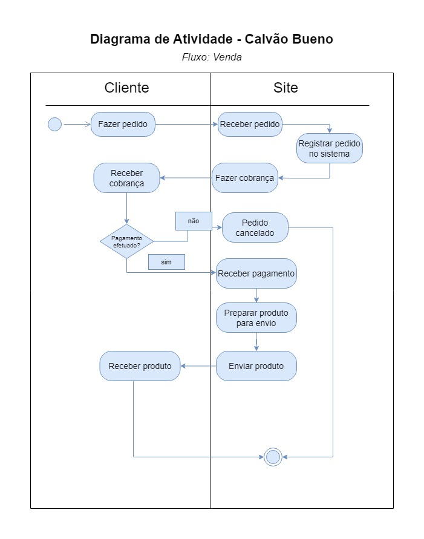
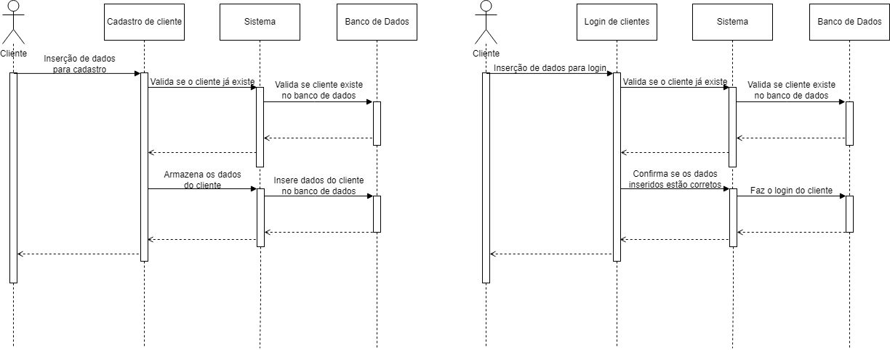
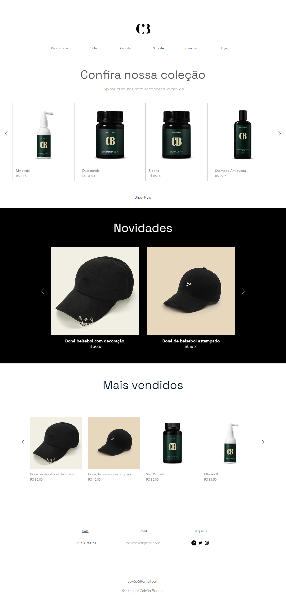
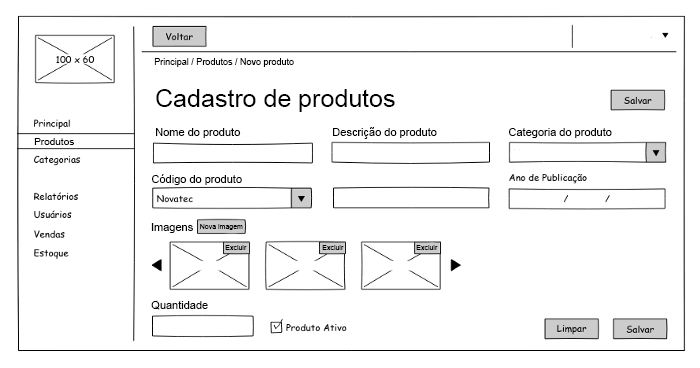

<h1> Projeto do site "Calvão Bueno"</h1>

### 👥 Membros

  

### 📜 Sobre a A3

 A proposta da A3 consistiu na modelagem de um site para uma loja online de vendas. Foram identificados e documentados tanto os requisitos funcionais quanto os requisitos não funcionais do sistema. Além disso, houve o design da página inicial do site, proporcionando uma visão do cliente ao visitar a plataforma. Também foi projetada a interface para o cadastro de produtos, destinada à administração do site. 

### 📜 Descrição da Loja 

 O projeto "Calvão Bueno" propõe a criação de uma loja online dedicada ao universo de produtos específicos para pessoas calvas e/ou carecas. Com o intuito de atender às necessidades desse público específico, a plataforma será desenvolvida para oferecer uma experiência de compra personalizada, contemplando desde produtos de cuidado pessoal até acessórios e itens relacionados à estética e bem-estar desse segmento. A especialização do projeto reflete o comprometimento em proporcionar soluções adaptadas e inclusivas, consolidando a loja como referência para aqueles que buscam produtos pensados especialmente para as particularidades da calvície.
 

---
<h2> Modelagem Técnica  </h2>

 

 <h3>🌺 Requisitos Funcionais</h3>

Aqui levantamos os requisitos do site. Escolhemos fazer tanto os requisitos do cliente que utilizará o site, quanto do Admin que irá gerenciar as vendas.

| CLIENTE | ADMIN |
|---------| ------|
|Requisito Funcional #1 - Cadastrar no sistema. | Requisito Funcional  #1 - Sistema deve listar os clientes.
Requisito Funcional #2 - Acessar os produtos do sistema. | Requisito Funcional  #2 - O sistema deve permitir criar, alterar e excluir uma categoria do sistema.
Requisito Funcional #3 - Caso perda de senha, o sistema deve enviar um e-mail para redefinir dados. | Requisito Funcional  #3 - O sistema deve permitir criar, alterar e excluir uma subcategoria do sistema.
Requisito Funcional #4 - O sistema deve ter um painel para acompanhamento de compra. | Requisito Funcional  #4 - O sistema deve permitir alterar o banner de publicidade do sistema.
Requisito Funcional #5 - O sistema deve ter um chat (SAC) para o cliente contatar a loja. | Requisito Funcional  #5 - O sistema deve permitir criar, alterar e excluir um produto do sistema, com respectivas imagens.
Requisito Funcional #6 - O sistema deve conseguir cancelar o pedido de um produto. | *Requisito Funcional  #6 - O sistema deve permitir criar relatórios de  vendas.
Requisito Funcional #7 - O cliente deve conseguir calcular  o frete do produto. | Requisito Funcional  #7 - O sistema deve permitir registrar problemas de vendas.
Requisito Funcional #8 - O cliente deve conseguir criar um carrinho de compras. | Requisito Funcional  #8 - O sistema deve fazer uma conexão de mais e menos comprados por cada cliente
Requisito Funcional #9 - O cliente precisa poder acompanhar o rastreio do seu pedido (caso tenha feito compra online) | Requisito Funcional #9 - O sistema deve mandar novidades para os clientes cadastrados na base de dados que permitirem essa interação
Requisito Funcional  #10 - O cliente deve poder decidir se quer ou não receber E-mails de comunicação de novos produtos | 

 

 <h3>🌱Requisitos Não Funcionais </h3>

| TIPO | DESCRIÇÃO |
|------|-----------|
|Usabilidade | O sistema deve ser de fácil entendimento para funcionários operar após determinado tempo de treinamento.
Eficiência | Os sistema deverá processar n requisições por um determinado tempo.
Confiabilidade | O sistema deverá ter alta disponibilidade (99,9% do tempo)..
Portabilidade | O sistema deverá ser executado em qualquer plataforma (Smartphone, Tablets, Computadores).
Segurança | O sistema deve ser capaz de se conectar com autenticadores de dois fatores, se solicitado; e mandar SMS e/ou email com código de autenticação.
Entrega | Um relatório de acompanhamento deverá ser fornecido toda segunda-feira.
Implementação | O sistema deverá ser desenvolvido na linguagem ------ (a ser decidido ainda)	
Padrões | Uso de programação orientada a objeto sob a plataforma A.
Interoperabilidade | O sistema deverá se comunicar com o banco SQL Server.	
Éticos | O sistema não apresentará aos usuários quaisquer dados de cunho privado, nem utilizar de forma indevida.
Legais | O sistema deverá atender as normas legais, tais como padrões, leis, etc. 	

 

 <h3> 📚 Diagramas: </h3>

 

 <h3> 📒 Casos de uso: </h3>

 

 <h3> 📕 Diagrama de classes </h3>

 

 <h3> 📗 Modelo Lógico do BD</h3>

 

 <h3> 📘 Diagrama de Relacionamento  </h3>

 

 <h3> 📙 Diagrama de Atividades   </h3>

 

 <h3> 📔  Diagrama de Sequência   </h3>

---
<h2> Protótipo </h2>

 

 <h3> 🖼 Página Inicial do Site: </h3>

Desenvolvemos a interface de forma a proporcionar simplicidade e conveniência ao cliente, incorporando um estilo temático mais vintage.

 

 <h3> 🏷 Dashboard cadastro de produtos</h3>

A seguir, apresentamos um protótipo que representa a interface pela qual o administrador (ADM) terá controle sobre os produtos e a gestão geral do site.

